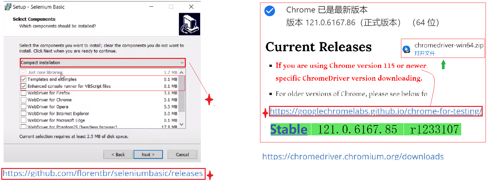

### Part 57.1 - Getting Started with Selenium Basic and Google Chrome

- ##### Downloading & Installing Selenium Basic  and Chrome Driver

  

- ##### Copying  Driver to the Selenium Folder & Referencing the selenium

  

- ##### Opening Google Chrome in VBA

  
