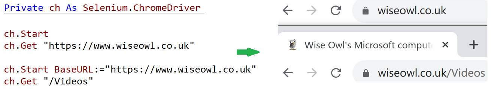

### Part 57.2 - Basic Web Scraping with Selenium and Google Chrome

- ##### Navigating to a URL

  

- ##### Typing Text into an Input Box

  

- ##### Handling the results

  

- ##### Writing an Entire Table into Excel

  

- ##### Writing Table Cell Text into Excel

  

