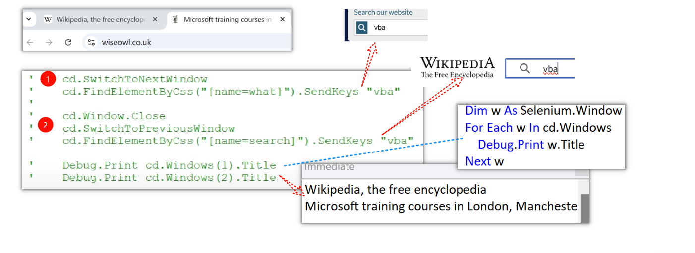

### Part 57.6 - Working with Multiple Tabs in Selenium

##### Open a new tab and navigating a url

##### Switch between  & windows

##### A practical example for Wikipedia

- The Stale Element Reference Errors

  

- Opening Multiple Tabs and Looping Through Them

  

- Opening One Window at a Time

  
